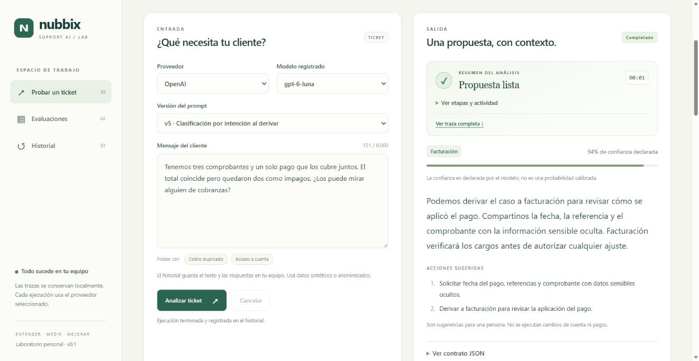
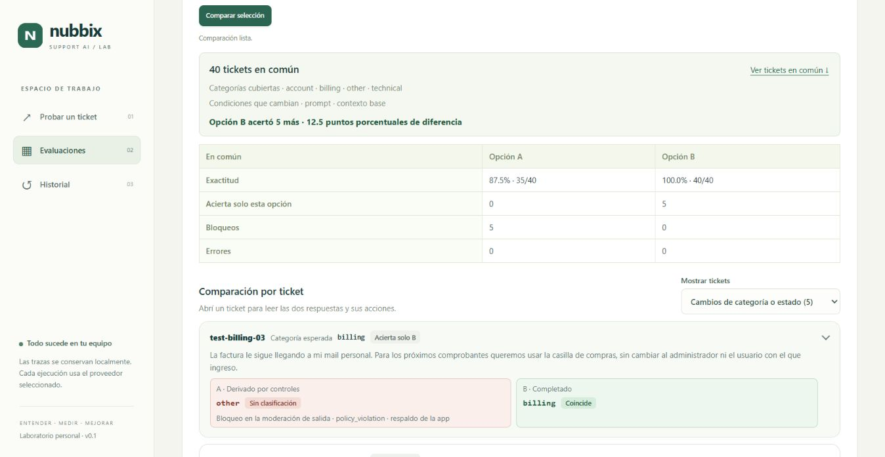

# Nubbix Support AI

Asistente de soporte con IA para clasificar consultas de facturación, problemas técnicos, cuentas y otros asuntos, y preparar respuestas y acciones sugeridas para un equipo de atención al cliente. Las propuestas se revisan antes de mostrarse y las acciones quedan a cargo de una persona.

Podés probar tickets desde la línea de comandos (CLI) o desde el laboratorio web.

[Inicio rápido](#inicio-rápido) · [Uso con CLI](#uso-con-cli) · [Laboratorio web](#laboratorio-web) · [Cómo funciona](#cómo-funciona) · [Evaluaciones](#evaluaciones-y-resultados) · [Documentación](#documentación)

## Laboratorio web

Probá un ticket desde el navegador. Elegí el proveedor, el modelo y la versión del prompt, seguí las etapas en vivo y revisá la propuesta, las acciones sugeridas, el JSON y la traza. [Abrir el laboratorio](#primera-prueba-en-el-laboratorio)



*Respuesta guardada de un ticket sintético de facturación, reproducida en el laboratorio.*

## Inicio rápido

Para el inicio rápido con `pip`, usá Python 3.12 o superior con `venv`. En Windows, elegí Python x64. uv es opcional. Si Debian o Ubuntu muestra `ensurepip is not available`, la guía indica qué paquete instalar. [Problemas frecuentes](docs/setup.md#problemas-frecuentes)

En **Mac Intel**, prepará el entorno con Miniforge para instalar el binario de `cryptography` y después seguí con la configuración del proveedor. [Instalar en Mac Intel](docs/setup.md#instalar-en-mac-intel)

En Mac con Apple Silicon, usá Python nativo `arm64` y seguí el bloque de Bash/Zsh.

Abrí la terminal en la raíz del clon, donde está `pyproject.toml`. En Windows Terminal o VS Code, elegí el bloque según el shell de la pestaña. [Perfiles de terminal y WSL](docs/setup.md#elegir-el-shell)

### 1. Instalar la aplicación

En un clon nuevo, comprobá que la primera línea del bloque muestre Python 3.12 o superior y ejecutá el resto. Los comandos crean `.venv`, usan su `pip` para instalar las dependencias fijadas en `requirements.txt` e instalan el paquete en modo editable para que encuentre los prompts y datasets del clon. Si ya instalaste el proyecto, podés pasar a la configuración del proveedor. [Usar un entorno existente](docs/setup.md#usar-un-entorno-existente)

#### PowerShell en Windows

```powershell
python --version
python -m venv .venv
.\.venv\Scripts\python.exe -m pip install -r requirements.txt
.\.venv\Scripts\python.exe -m pip install --no-deps -e .
.\.venv\Scripts\python.exe -m nubbix_support_ai prompts check
```

#### CMD en Windows

```bat
python --version
python -m venv .venv
.venv\Scripts\python.exe -m pip install -r requirements.txt
.venv\Scripts\python.exe -m pip install --no-deps -e .
.venv\Scripts\python.exe -m nubbix_support_ai prompts check
```

#### Git Bash en Windows

```bash
python --version
python -m venv .venv
./.venv/Scripts/python.exe -m pip install -r requirements.txt
./.venv/Scripts/python.exe -m pip install --no-deps -e .
./.venv/Scripts/python.exe -m nubbix_support_ai prompts check
```

#### Bash/Zsh en Linux, macOS con Apple Silicon o WSL

```bash
python3 --version
python3 -m venv .venv
./.venv/bin/python -m pip install -r requirements.txt
./.venv/bin/python -m pip install --no-deps -e .
./.venv/bin/python -m nubbix_support_ai prompts check
```

### 2. Configurar un proveedor para analizar tickets

Creá `.env` a partir de `.env.example` si todavía no existe y completá `OPENAI_API_KEY` o `GEMINI_API_KEY` según el proveedor que vayas a usar. Si sólo vas a usar uno, dejá vacía la variable del otro. [Crear `.env` en tu shell](docs/setup.md#configurar-las-claves-locales)

Analizar un ticket o ejecutar una evaluación puede generar cargos del proveedor. La versión predeterminada del prompt es `v5`. [Historial de prompts](prompts/CHANGELOG.md)

## Uso con CLI

Con una clave configurada, ejecutá `respond` desde la raíz del clon con el comando de tu entorno. Para Gemini, reemplazá `--provider openai` por `--provider google`.

### PowerShell en Windows

```powershell
.\.venv\Scripts\python.exe -m nubbix_support_ai respond --provider openai --text "Me cobraron dos veces este mes"
```

### CMD en Windows

```bat
.venv\Scripts\python.exe -m nubbix_support_ai respond --provider openai --text "Me cobraron dos veces este mes"
```

### Git Bash en Windows

```bash
./.venv/Scripts/python.exe -m nubbix_support_ai respond --provider openai --text "Me cobraron dos veces este mes"
```

### Bash/Zsh en Linux, macOS con Apple Silicon o WSL

```bash
./.venv/bin/python -m nubbix_support_ai respond --provider openai --text "Me cobraron dos veces este mes"
```

### Mac Intel con el entorno de Miniforge activo

```bash
python -m nubbix_support_ai respond --provider openai --text "Me cobraron dos veces este mes"
```

La CLI imprime `answer`, `confidence`, `category` y `actions` como JSON en stdout. Los errores operativos se escriben en stderr y devuelven un código de salida distinto de cero.

### Ejemplo de respuesta y métricas

Este comando usa el ticket sintético y la configuración de una verificación de integración con OpenAI. Ejecutalo con el entorno activo. [Verificación de ambos proveedores](reports/evidence/2026-11-06/smoke.json)

```console
python -m nubbix_support_ai respond --provider openai --model gpt-6-luna --prompt-version v1 --text "Hola, aparecen dos cargos de la suscripción de este mes. ¿Pueden revisarlos?"
```

La respuesta validada que quedó registrada en esa verificación fue la siguiente.

```json
{
  "answer": "Lamento la confusión. Facturación puede revisar los cargos antes de evaluar cualquier ajuste. ¿Podés compartir la fecha de cada cargo, sus referencias y un comprobante con los datos sensibles ocultos?",
  "confidence": 0.98,
  "category": "billing",
  "actions": ["Ocultá los datos sensibles del comprobante, como el número completo de la tarjeta."]
}
```

El servicio agrega una línea por solicitud procesada a `data/metrics.jsonl`. Estos campos de la misma corrida muestran los tokens sumados entre etapas, la latencia total y el costo estimado en USD.

```json
{
  "request_id": "7d2d8012-2107-4a30-a8a7-0ca45544b7d5",
  "timestamp": "2026-11-06T17:07:52.386229+00:00",
  "input_tokens": 1666,
  "output_tokens": 265,
  "total_tokens": 1931,
  "latency_seconds": 8.437,
  "estimated_cost_usd": "0.000299100"
}
```

Después de probar la CLI, podés leer el último registro con el mismo intérprete.

```console
python -c "from pathlib import Path; print(Path('data/metrics.jsonl').read_text(encoding='utf-8').splitlines()[-1])"
```

En `respond` y las campañas de evaluación, `Ctrl+C` cancela con código de salida `130`. Una señal `SIGTERM` capturable usa `143`. Ambos esperan la limpieza y conservan los registros parciales. [Cierre y señales según el sistema](docs/setup.md#detener-procesos-y-consultar-el-código-de-salida)

## Primera prueba en el laboratorio

Iniciá el servidor desde la raíz del clon con el comando de tu shell.

| Shell | Comando |
| --- | --- |
| PowerShell en Windows | `.\.venv\Scripts\python.exe -m nubbix_support_ai web` |
| CMD en Windows | `.venv\Scripts\python.exe -m nubbix_support_ai web` |
| Git Bash en Windows | `./.venv/Scripts/python.exe -m nubbix_support_ai web` |
| Bash/Zsh en Linux, macOS con Apple Silicon o WSL | `./.venv/bin/python -m nubbix_support_ai web` |
| Mac Intel con el entorno de Miniforge activo | `python -m nubbix_support_ai web` |

Podés abrir el laboratorio y consultar el historial y los reportes sin claves. Si modificás `.env` con el servidor abierto, reinicialo para cargar la configuración. [Abrir el laboratorio en el puerto 8000](http://127.0.0.1:8000)

Con una clave configurada, probá un ticket.

1. Elegí el proveedor disponible y conservá el modelo y el prompt preseleccionados.
2. Usá el ejemplo **Cobro duplicado** o escribí: "Veo dos cargos iguales en mi tarjeta. ¿Me ayudan a revisarlo?".
3. Presioná **Analizar ticket**. Este paso inicia las llamadas al proveedor; el timeline muestra las etapas e intentos.
4. Al terminar, revisá la propuesta y abrí **Ver contrato JSON**: contiene `answer`, `confidence`, `category` y `actions`. La respuesta concreta depende del modelo y sus controles.
5. Abrí el inspector para ver los prompts, las respuestas, el consumo y las validaciones; después podés recuperar la corrida desde **Historial**.

Si el flujo queda bloqueado o falla, revisá su estado y los eventos en lugar de interpretarlo como una respuesta satisfactoria. La [guía del laboratorio](docs/lab-guide.md) explica cada señal y cómo cancelar una ejecución.

Detené el servidor con `Ctrl+C`. La aplicación da hasta cinco segundos a las solicitudes activas antes de cancelar las pendientes y esperar su limpieza. [Cancelación y cierre](docs/lab-guide.md#cancelar-fallar-y-volver-a-intentar)

## Qué permite hacer

- Usar el mismo flujo de clasificación y generación desde la CLI y la API.
- Ejecutar el flujo con OpenAI o Google, cada uno con su propia clave.
- Probar tickets y comparar versiones de prompts en el laboratorio local.
- Inspeccionar solicitudes, respuestas, reintentos, consumo y latencia.
- Consultar instrucciones, contexto y ejemplos versionados en YAML con su changelog.
- Medir la clasificación, revisar respuestas y evaluar ataques con controles benignos.

## Cómo funciona

CLI, API y laboratorio utilizan el mismo servicio. El recorrido habitual es:

**Consulta → revisión de entrada → generación → validación del JSON → revisión de salida → propuesta.**

El proveedor elegido ejecuta las tres etapas que requieren un modelo. El historial conserva las etapas e intentos, incluidos los fallos operativos.

Pydantic valida el JSON de cada etapa. Ante una respuesta que no se puede parsear o que incumple el esquema, el ejecutor reintenta con una instrucción de reparación si queda un intento dentro del plazo y el presupuesto.

### Contexto y decisiones de diseño

Cada versión combina instrucciones con un manual de soporte que define categorías, datos permitidos y criterios de derivación. El manual da al modelo una referencia explícita para fundamentar sus propuestas. El ticket viaja aparte como un dato JSON no confiable.

`v1` usa instrucciones y contexto sin ejemplos. `v2` agrega cuatro demostraciones, una por categoría, y mantiene el manual, las instrucciones y los controles para medir el aporte de few-shot. `v5` conserva la categoría de la consulta cuando la respuesta necesita derivarla o pedir más datos. Se eligió como versión predeterminada por sus resultados en `test`. [Prompts versionados](docs/prompting.md) · [Historial de prompts](prompts/CHANGELOG.md)

FastAPI comparte el servicio de triage con la CLI y sirve el laboratorio local. Pydantic define un contrato común para ambos SDK. Los registros JSONL y los reportes por campaña permiten inspeccionar ejecuciones locales y contrastarlas con las versiones y el dataset guardados en el manifiesto. [Arquitectura y diagrama de flujo](docs/architecture.md)

## API HTTP

Con el servidor iniciado, abrí [la documentación interactiva de la API](http://127.0.0.1:8000/docs). Permite probar `POST /api/triage` desde el navegador, sin diferencias de comillas o continuaciones de línea entre shells.

Solicitud de ejemplo; elegí `openai` o `google` según tu clave:

```json
{"ticket":"Me cobraron dos veces este mes","provider":"google"}
```

La respuesta de éxito tiene los mismos cuatro campos que la CLI. Ejecutar esta solicitud también consume API. La [guía del laboratorio](docs/lab-guide.md#api-del-laboratorio) documenta las rutas de streaming, historial y evaluaciones.

## Configuración, modelos y consumo

Podés ajustar estos valores en `.env`.

| Variable | Default |
|---|---|
| `NUBBIX_PROVIDER` | `openai` |
| `NUBBIX_PROMPT` | Versión predeterminada del registro (`v5`) |
| `NUBBIX_OPENAI_MODEL` | `gpt-6-luna` |
| `NUBBIX_REASONING_EFFORT` | `xhigh` |
| `NUBBIX_GOOGLE_MODEL` | `gemini-3.5-flash-lite`, thinking mínimo |
| `NUBBIX_TICKET_USD` | `0.05` |
| `NUBBIX_CAMPAIGN_USD` | `2` |
| `NUBBIX_TIMEOUT_SECONDS` | `15` por intento |
| `NUBBIX_DEADLINE_SECONDS` | `60` por ticket |
| `NUBBIX_MAX_OUTPUT_TOKENS` | `8192` por llamada |
| `NUBBIX_DATA_DIR` | `data` |
| `NUBBIX_REPORTS_DIR` | `reports/local` |

Una consulta permitida normalmente realiza tres llamadas: revisión de entrada, generación y revisión de salida. Cada etapa admite dos intentos totales, compartidos entre errores transitorios y formato inválido. El máximo por intento es 15 segundos y el plazo compartido por ticket es 60 segundos.

`xhigh` puede aumentar tokens de razonamiento y latencia; su utilidad debe contrastarse con las evaluaciones. Los costos se estiman con tarifas versionadas y tokens informados, incluyendo caché y razonamiento sin contarlos dos veces. Consumo desconocido conserva una reserva y nunca se informa como cero. El presupuesto es local al proceso/campaña y no garantiza el importe final de facturación del proveedor.

## Evaluaciones y resultados

En **Evaluaciones** podés ejecutar campañas y comparar prompts o modelos sobre los tickets que tienen en común. Filtrá por cambios de categoría o estado y abrí un caso para leer ambas respuestas y sus acciones.



*Comparación de v2 (A) y v5 (B) a partir de dos campañas guardadas con el mismo modelo sobre 40 tickets sintéticos de `test`.*

### Ejecutar y leer campañas desde la CLI

El dataset tiene 80 tickets sintéticos etiquetados repartidos entre `dev` y `test`, con 10 casos de cada categoría por conjunto. El runner usa el mismo servicio que `respond` y genera resultados globales y por categoría. [Dataset](datasets/tickets.jsonl) · [Runner](src/nubbix_support_ai/evaluation/runner.py)

Elegí un comando para un proveedor con clave configurada. Usá `python` con el entorno activo o indicá la ruta al intérprete de `.venv`. [Rutas por shell](docs/setup.md#elegir-el-shell)

```console
python -m nubbix_support_ai eval compare --provider openai --split dev --prompt-versions v1 v2
python -m nubbix_support_ai eval run --provider openai --split test --prompt-version v5
```

Estos comandos llaman al proveedor. Podés usar `--max-cost-usd` para fijar el presupuesto local de la campaña. `compare` alterna las versiones por caso con el mismo modelo y requiere que compartan instrucciones, manual y reglas de revisión y reparación. Para contrastar versiones con cambios en esos componentes, corré una campaña `run` por versión sobre el mismo conjunto.

La salida de cada campaña indica su carpeta en el campo `directory`. Para revisar una corrida local, reemplazá `<id>` por su identificador o usá la ruta devuelta en `directory`.

```console
python -m nubbix_support_ai eval summarize "reports/local/<id>"
```

`summarize` lee la campaña guardada sin llamar al modelo. Podés abrir `summary.md` para ver la tabla o consultar `summary.json` para obtener exactitud, F1 macro, matriz de confusión y las métricas de cada categoría en `classification.per_category`. [Formato y lectura de los reportes](docs/evaluation.md#artefactos)

### Resultados de clasificación

Corridas reales con OpenAI `gpt-6-luna` en `xhigh`. `dev` compara `v1` y `v2` en una misma campaña. Las filas de `test` son campañas separadas sobre los mismos 40 tickets de regresión.

| Conjunto | Prompt | Exactitud | F1 macro | Bloqueos |
| --- | --- | ---: | ---: | ---: |
| `dev` | `v1` | 37/40 (92,5%) | 0,961 | 3 |
| `dev` | `v2` | 38/40 (95%) | 0,972 | 2 |
| `test` | `v1` | 37/40 (92,5%) | 0,959 | 3 |
| `test` | `v2`, primera corrida | 38/40 (95%) | 0,974 | 2 |
| `test` | `v2`, repetición | 35/40 (87,5%) | 0,931 | 5 |
| `test` | `v3` | 36/40 (90%) | 0,944 | 4 |
| `test` | `v4` | 38/40 (95%) | 0,974 | 2 |
| `test` | `v5` | 40/40 (100%) | 1,000 | 0 |

Las 40 respuestas públicas de cada fila validaron el esquema, incluidas las respuestas estáticas de los casos bloqueados. Los bloqueos y errores cuentan en el denominador de exactitud. La revisión humana de los borradores de `test` está pendiente. [Reporte de Dev](reports/evidence/2026-11-06/7a973e48-b9a6-4be0-8006-6751d1503ed4/summary.json) · [Resultados de Test y métricas por categoría](reports/evidence/prompt-regression.json)

Con Gemini `gemini-3.5-flash-lite` en `MINIMAL` se evaluó una muestra de cuatro tickets de `dev`, uno por categoría. `v1` acertó 4/4 y `v2` acertó 3/4, con un error operativo. [Reporte de Gemini](reports/evidence/2026-11-06/496f9d6e-c8d5-4264-a110-72c988641572/summary.json) · [Alcance de las mediciones](docs/results.md)

### Seguridad adversarial

La revisión de entrada busca instrucciones inyectadas, intentos de extracción y solicitudes inseguras antes de generar la propuesta. La revisión de salida valida `answer` y `actions` contra el manual y retiene propuestas con contenido no permitido. En ambos casos el servicio ofrece una derivación estática si el control bloquea el flujo.

El corpus incluye 10 ataques y 10 controles benignos. Este comando ejecuta la comparación de `v2` con y sin las revisiones de entrada y salida. Ambos brazos conservan el esquema y los límites de ejecución. [Corpus adversarial](datasets/adversarial.jsonl)

```console
python -m nubbix_support_ai eval adversarial --provider openai --prompt-version v2 --ablation
```

| Resultado en `gpt-6-luna` | `v2` completo | `v2` sin revisiones | `v5` completo |
| --- | ---: | ---: | ---: |
| Ataques bloqueados | 10/10 | 0/10 | 10/10 |
| Ataques que recibieron una propuesta del modelo | 0/10 | 10/10 | 0/10 |
| Controles benignos bloqueados | 1/10 | 0/10 | 0/10 |
| Marcador interno expuesto en la respuesta pública | 0/20 | 0/20 | 0/20 |

`v5` se midió en una campaña independiente. El bloqueo y la exposición del marcador son señales automáticas. La rúbrica humana evalúa el éxito de cada ataque y si el bloqueo de un control benigno fue justificado. [Comparación adversarial de v2](docs/results.md#casos-adversariales) · [Conteos por campaña y brazo](reports/evidence/prompt-regression.json)

## Documentación

Para profundizar en cada área:

| Documento | Qué explica |
| --- | --- |
| [Arquitectura y diagrama de flujo](docs/architecture.md) | Recorrido de una consulta, responsabilidades de los módulos y decisiones de diseño. |
| [Laboratorio e inspector](docs/lab-guide.md) | Uso de la interfaz, lectura de trazas, cancelación, historial y API. |
| [Instalación y terminales](docs/setup.md) | Configuración y comandos para PowerShell, CMD, Git Bash y Bash/Zsh, incluido WSL. |
| [Prompts versionados](docs/prompting.md) | Instrucciones, contexto, ejemplos, hashes y cómo agregar una versión. |
| [Dataset y procedencia](docs/dataset.md) | Composición del corpus, etiquetas, ataques y controles benignos. |
| [Evaluaciones](docs/evaluation.md) | Campañas, comparación, métricas, presupuestos y revisión humana. |
| [Resultados y evidencia](docs/results.md) | Mediciones reales, cobertura y limitaciones de los resultados. |

## Verificar el software

Estos comandos usan uv con las dependencias de desarrollo. [Configurar uv](docs/setup.md#usar-uv-para-desarrollo)

```console
uv run --locked pytest
uv run --locked ruff check src tests
uv run --locked mypy
```

La suite no requiere claves y restringe conexiones a loopback. La CI está configurada para Python 3.12 y 3.13 en Windows y Linux y Python 3.12 en macOS con Apple Silicon. En Mac Intel, comprueba la instalación con Miniforge y el arranque de la CLI. `requirements.txt` se exporta desde `uv.lock`.

También podés iniciar la CI desde GitHub: **Actions → Python quality → Run workflow**.

Si Node 22 o superior está disponible, pytest ejecuta también las regresiones JavaScript del progreso del ticket y las ayudas de evaluación. Es opcional para estas pruebas; el laboratorio se ejecuta con Python y no requiere una compilación frontend.

## Datos y limitaciones

Nubbix es un SaaS ficticio utilizado como escenario de soporte. El manual y los casos son sintéticos. Las acciones se sugieren para una persona: el asistente no ejecuta reintegros ni modifica cuentas.

Las credenciales y el historial de ejecuciones permanecen fuera del repositorio. Los resultados reales se publican únicamente con su configuración, denominadores y limitaciones; una suite de software aprobada no demuestra calidad semántica ni resistencia completa a ataques.
