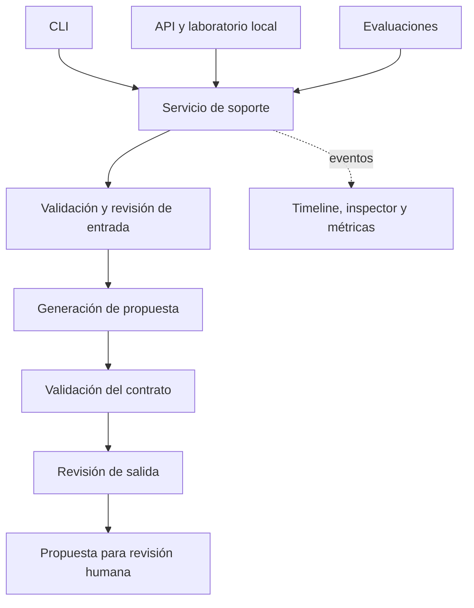

# Arquitectura

Este documento describe el diseño de Nubbix Support AI. La implementación de los componentes está pendiente.

## Flujo de soporte

El servicio recibe una consulta en texto libre, revisa su entrada, genera una propuesta y valida tanto su estructura como su contenido. CLI, API y evaluaciones utilizan el mismo flujo para que los resultados no dependan de la interfaz elegida.



Un bloqueo de seguridad dará lugar a una derivación explícita. Los fallos operativos, como un timeout o un error de autenticación, se informarán como errores, sin presentarlos como respuestas de soporte satisfactorias.

## Contrato de respuesta

La respuesta pública tendrá cuatro campos. Este es un ejemplo del formato, no un resultado medido:

```json
{
  "answer": "Compartinos la fecha y la referencia del cargo, ocultando cualquier dato sensible, para que el equipo de facturación pueda revisarlo.",
  "confidence": 0.82,
  "category": "billing",
  "actions": ["Derivar la revisión del cargo al equipo de facturación."]
}
```

Las categorías serán `billing`, `technical`, `account` y `other`. La confianza es una estimación del modelo y no una probabilidad calibrada. Las acciones son recomendaciones para un agente humano.

Los metadatos de ejecución y el inspector tendrán un contrato interno separado, para conservar estable la respuesta pública.

## Responsabilidades

| Módulo | Responsabilidad |
|---|---|
| `support` | Contratos, políticas y coordinación del caso de uso. |
| `llm` | Interfaz común de proveedor, adaptadores SDK y llamadas estructuradas. |
| `prompting` | Carga y validación de versiones YAML. |
| `observability` | Eventos, consumo, costo estimado e historial de inspección. |
| `evals` | Ejecución de casos, puntuación y comparación de resultados. |
| `web` | API, transmisión de eventos e interfaz del laboratorio. |

Una composición central administrará la configuración y el ciclo de vida de los clientes async. Los adaptadores no crearán event loops ni tomarán decisiones de negocio.

## Decisiones de diseño

### Aplicación modular en un solo proceso

FastAPI servirá la API y el laboratorio local en HTML, CSS y JavaScript. Esta organización permite mantener un solo entorno de ejecución y compartir los contratos con la CLI y las evaluaciones. El costo es escribir la interfaz y gestionar explícitamente sus estados.

La separación de módulos sigue responsabilidades concretas. Se utilizará un `Protocol` para los proveedores porque existen dos implementaciones intercambiables; no se introduce una jerarquía genérica de agentes o etapas.

### Proveedores independientes

OpenAI y Google podrán ejecutar el flujo completo usando únicamente su propia clave. Cada proveedor se encargará de revisar la entrada, generar y revisar la salida.

Este enfoque facilita comparar pipelines completos y evita una dependencia cruzada de credenciales. Implica normalmente tres llamadas por consulta y no garantiza que el revisor detecte todos los errores del generador, especialmente si ambos usan el mismo modelo.

### Prompts reproducibles

Cada versión dispondrá de sus propios archivos de instrucciones, contexto, seguridad y ejemplos opcionales. Un registro permitirá descubrir las versiones sin modificar el código del servicio.

Los hashes del contenido efectivo y el changelog permitirán relacionar una ejecución con el prompt utilizado. La duplicación entre versiones es intencional cuando ayuda a evitar cambios retroactivos en una configuración ya evaluada.

### Registros separados

- **Métricas JSONL:** una fila por consulta con estado, tokens, latencia y costo estimado.
- **Historial local:** eventos, prompts y respuestas para inspeccionar cada ejecución.
- **Reportes de evaluación:** resultados por caso, agregados y revisiones humanas.

El contenido del historial y las credenciales quedarán fuera de Git. La persistencia mediante archivos es suficiente para el alcance local; no se requiere una base de datos ni un servicio externo de trazas.

El timeline mostrará eventos de las etapas e intentos. La respuesta pública sólo se presentará después de completar la validación y los controles de salida.

## Evaluación y límites

Las pruebas de software verificarán contratos, reintentos, errores y cancelaciones con transportes controlados. Un runner separado ejecutará los casos contra los proveedores reales.

La evaluación distinguirá clasificación, cumplimiento del esquema, utilidad, fidelidad al contexto, seguridad, latencia y costo. Los errores y las abstenciones permanecerán en los denominadores; las revisiones humanas pendientes se identificarán como pendientes.

Los casos adversariales se acompañarán de controles benignos para medir tanto ataques exitosos como bloqueos injustificados. Un JSON válido o una suite de tests aprobada no demostrarán por sí solos la calidad de las respuestas ni resistencia completa a ataques.

El alcance inicial es un laboratorio personal con datos sintéticos. El diseño no contempla operación multiusuario, ejecución de acciones sobre sistemas de clientes ni garantías de calidad sobre tráfico real.
