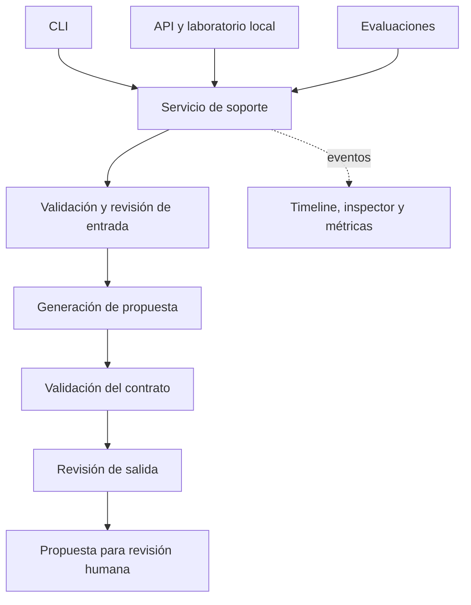

# Arquitectura

Este documento describe el flujo implementado de Nubbix Support AI y las decisiones que lo sustentan.

## Flujo de soporte

El servicio recibe una consulta en texto libre, revisa su entrada, genera una propuesta y valida tanto su estructura como su contenido. CLI, API y evaluaciones utilizan el mismo flujo para que los resultados no dependan de la interfaz elegida.



Un bloqueo de seguridad da lugar a una derivación explícita. Los fallos operativos, como un timeout o un error de autenticación, se informan como errores, sin presentarlos como respuestas de soporte satisfactorias.

## Contrato de respuesta

La respuesta pública tiene cuatro campos. Este es un ejemplo del formato, no un resultado medido:

```json
{
  "answer": "Compartinos la fecha y la referencia del cargo, ocultando cualquier dato sensible, para que el equipo de facturación pueda revisarlo.",
  "confidence": 0.82,
  "category": "billing",
  "actions": ["Derivar la revisión del cargo al equipo de facturación."]
}
```

Las categorías son `billing`, `technical`, `account` y `other`. La confianza es una estimación del modelo y no una probabilidad calibrada. Las acciones son recomendaciones para un agente humano.

Los metadatos de ejecución y el inspector tienen un contrato interno separado, para conservar estable la respuesta pública.

## Responsabilidades

| Módulo | Responsabilidad |
|---|---|
| `support` | Contratos, políticas y coordinación del caso de uso. |
| `llm` | Interfaz común de proveedor, adaptadores SDK y llamadas estructuradas. |
| `prompting` | Carga y validación de versiones YAML. |
| `observability` | Eventos, consumo, costo estimado e historial de inspección. |
| `evaluation` | Ejecución de casos, puntuación y comparación de resultados. |
| `web` | API, transmisión de eventos e interfaz del laboratorio. |

`Runtime` administra la configuración y el ciclo de vida de los clientes async. Los adaptadores no crean event loops ni toman decisiones de negocio.

Los casos versionados están en `datasets/`; las evaluaciones se ejecutan desde la CLI, sin un runner adicional en la raíz. `data/` contiene registros locales y `reports/local/`, los resultados generados. Las mediciones seleccionadas para publicar están en `reports/evidence/`.

## Decisiones de diseño

### Aplicación modular en un solo proceso

FastAPI sirve la API y el laboratorio local en HTML, CSS y JavaScript. Esta organización permite mantener un solo entorno de ejecución y compartir los contratos con la CLI y las evaluaciones. El costo es escribir la interfaz y gestionar explícitamente sus estados.

La separación de módulos sigue responsabilidades concretas. Los proveedores comparten un `Protocol` porque existen dos implementaciones intercambiables; no se introduce una jerarquía genérica de agentes o etapas.

### Proveedores independientes

OpenAI y Google ejecutan el flujo completo usando únicamente su propia clave. Cada proveedor revisa la entrada, genera y revisa la salida.

Este enfoque facilita comparar pipelines completos y evita una dependencia cruzada de credenciales. Implica normalmente tres llamadas por consulta y no garantiza que el revisor detecte todos los errores del generador, especialmente si ambos usan el mismo modelo.

### Prompts reproducibles

Cada versión dispone de sus propios archivos de instrucciones, contexto, seguridad y ejemplos opcionales. Un registro permite descubrir las versiones sin modificar el código del servicio.

Los hashes del contenido efectivo y el changelog permiten relacionar una ejecución con el prompt utilizado. La duplicación entre versiones es intencional cuando ayuda a evitar cambios retroactivos en una configuración ya evaluada.

### Registros separados

- **Métricas JSONL:** una fila por consulta con estado, tokens, latencia y costo estimado.
- **Historial local:** eventos, prompts y respuestas para inspeccionar cada ejecución.
- **Reportes de evaluación:** resultados por caso, agregados y revisiones humanas.

El contenido del historial y las credenciales quedan fuera de Git. La persistencia mediante archivos es suficiente para el alcance local; no se requiere una base de datos ni un servicio externo de trazas.

El timeline muestra eventos de las etapas e intentos. La respuesta pública sólo se presenta después de completar la validación y los controles de salida. Tanto `/api/triage` como los streams supervisan la conexión: una desconexión cancela y espera el trabajo pendiente.

### Cancelación y cierre de recursos

El servicio usa la cancelación nativa de tareas de `asyncio`. `CancelledError` atraviesa las etapas y los adaptadores sin activar reintentos. Los bloques de limpieza registran el estado `cancelled`, concilian el presupuesto y guardan el inspector; las evaluaciones conservan los casos terminados y su resumen parcial.

La CLI instala temporalmente un handler de `SIGTERM` alrededor de `respond` y `eval run/compare/adversarial`. La primera señal solicita cancelar la tarea principal; las siguientes dejan terminar su limpieza. El handler anterior se restaura al salir. `asyncio.run` conserva el manejo de `SIGINT`: la CLI traduce las interrupciones a stderr sanitizado y códigos `143` y `130`, respectivamente. El cierre de `Runtime` se ejecuta en una tarea protegida con `asyncio.shield` y se espera incluso si la primera señal llega durante el cierre de clientes.

El servidor configura `timeout_graceful_shutdown=5` en Uvicorn. Primero deja de aceptar conexiones y espera las solicitudes activas durante esa ventana. Después cancela las pendientes; el ciclo de vida de la aplicación drena el trabajo antes de cerrar los clientes SDK. Los cinco segundos limitan la espera de solicitudes, no la duración total del cierre con persistencia y limpieza.

Las rutas y el ciclo de vida comparten `web/lifecycle.py`: solicita la cancelación una sola vez y espera las tareas bajo un `CancelScope` protegido de AnyIO, la biblioteca que ya usa Starlette. Esto evita que el cierre del stream y el del servidor interrumpan otra vez una limpieza async en curso. La protección se limita al drenaje; el procesamiento sigue siendo cancelable.

Las integraciones de servidor usan Uvicorn real con sockets locales efímeros y proveedores controlados: verifican una solicitud que termina durante la gracia, solicitudes JSON/NDJSON que se cancelan al vencerla y limpieza async demorada en streams de tickets y evaluaciones. Las desconexiones se prueban con las variantes de ASGI 2.3 y 2.4. Las pruebas de CLI entregan señales al proceso y verifican códigos de salida, restauración de handlers, reportes parciales y cierre de recursos. No requieren claves ni llaman a modelos. La [guía de terminales](setup.md#detener-procesos-y-consultar-el-código-de-salida) explica los límites del cierre forzado y las diferencias de Windows.

## Evaluación y límites

Las pruebas de software verifican contratos, reintentos, errores y cancelaciones con transportes controlados. El runner ejecuta los casos contra los proveedores reales.

La evaluación distingue clasificación, cumplimiento del esquema, utilidad, fidelidad al contexto, seguridad, latencia y costo. Los errores y las abstenciones permanecen en los denominadores; las revisiones humanas pendientes se identifican como pendientes.

Los casos adversariales se acompañan de controles benignos para medir tanto ataques exitosos como bloqueos injustificados. Un JSON válido o una suite de tests aprobada no demuestra por sí solo la calidad de las respuestas ni resistencia completa a ataques.

El alcance inicial es un laboratorio personal con datos sintéticos. El diseño no contempla operación multiusuario, ejecución de acciones sobre sistemas de clientes ni garantías de calidad sobre tráfico real.
